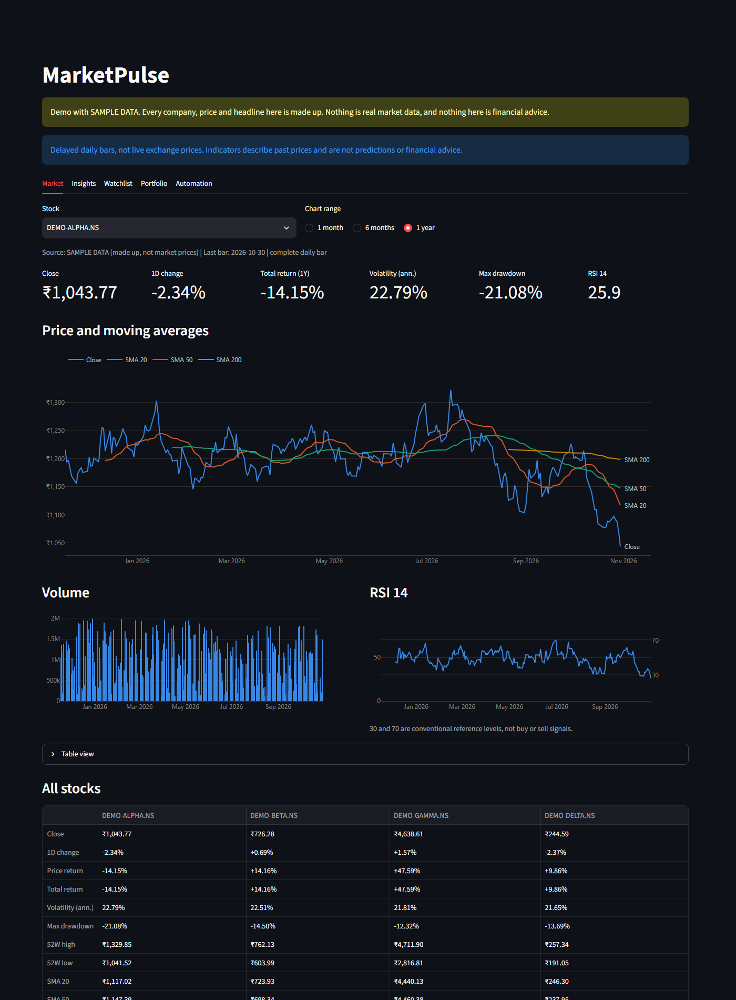

# MarketPulse

[](https://github.com/praveen-here50/Market-Pulse/actions/workflows/tests.yml)

I built this to track Indian stocks and learn backend development in Python along the way.

It pulls daily NSE prices, shows them on a dashboard, tracks my trades, and sends me a
report on Telegram after the market closes.



## Features

- Price charts with moving averages, RSI and other basic metrics
- Portfolio tracking from a list of trades, including stock splits
- Daily Telegram report and price alerts, scheduled with n8n
- Short AI note from Gemini, checked in Python before it's sent
- Falls back to NSE bhavcopy files if Yahoo is down

## Tech stack

Python, FastAPI, Streamlit, pandas, Plotly, SQLite, n8n, Telegram Bot API, Gemini API, pytest

## Try it

There's a demo mode with made-up stocks and prices, so you don't need any accounts or keys.

```bat
py -3.12 -m venv .venv
.venv\Scripts\python.exe -m pip install -r requirements.txt
run_demo.bat
```

Then open http://127.0.0.1:8502. In PowerShell, use `.\run_demo.bat`.

The screenshots here come from the demo, so none of the prices are real.

## Run it with real data

Install n8n once:

```bat
cd automation
npm ci
cd ..
```

Create a `.env` file in the main folder:

```text
TELEGRAM_BOT_TOKEN=your-token
TELEGRAM_CHAT_ID=your-chat-id
GEMINI_API_KEY=your-key
```

Then load the token and workflows into n8n, and start everything:

```bat
.venv\Scripts\python.exe automation\import_telegram_credential.py
automation\start_n8n.bat import:workflow --input=workflows\marketpulse_daily_report.json
automation\start_n8n.bat import:workflow --input=workflows\marketpulse_alerts.json
run_marketpulse.bat
```

Open the workflows at http://127.0.0.1:5678 and publish them. The dashboard is at
http://127.0.0.1:8501.

## Tests

```bat
.venv\Scripts\python.exe -m pytest
```

## Good to know

- It runs on my own computer and has no login, so don't expose it to a network.
- Prices are delayed daily closes, not live.
- Yahoo data comes through `yfinance`, which is unofficial and meant for personal use.
  No market data is included in this repo.
- It's a learning project and not financial advice. It isn't connected to Yahoo, NSE,
  Google, Telegram or n8n.

## License

[MIT](LICENSE)
